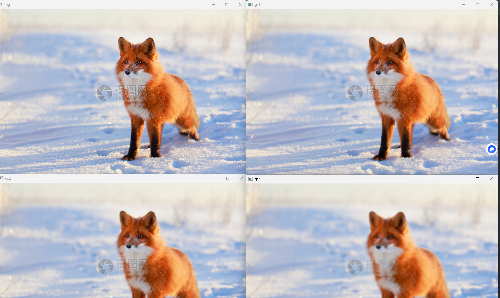
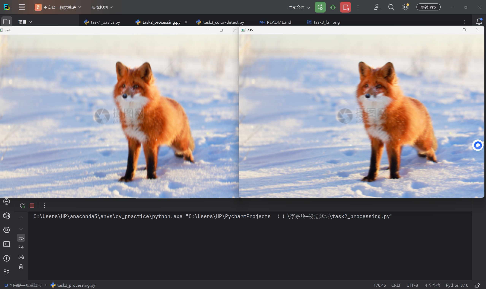
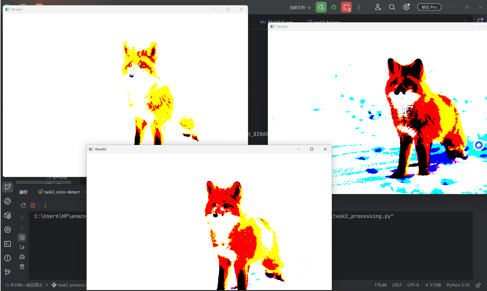
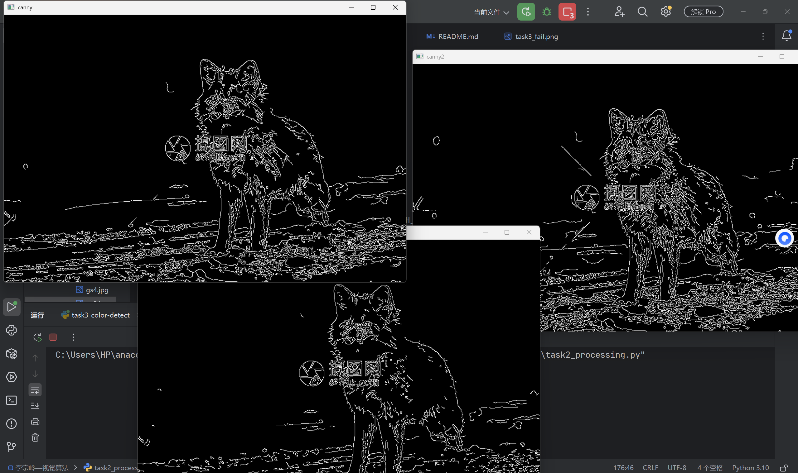
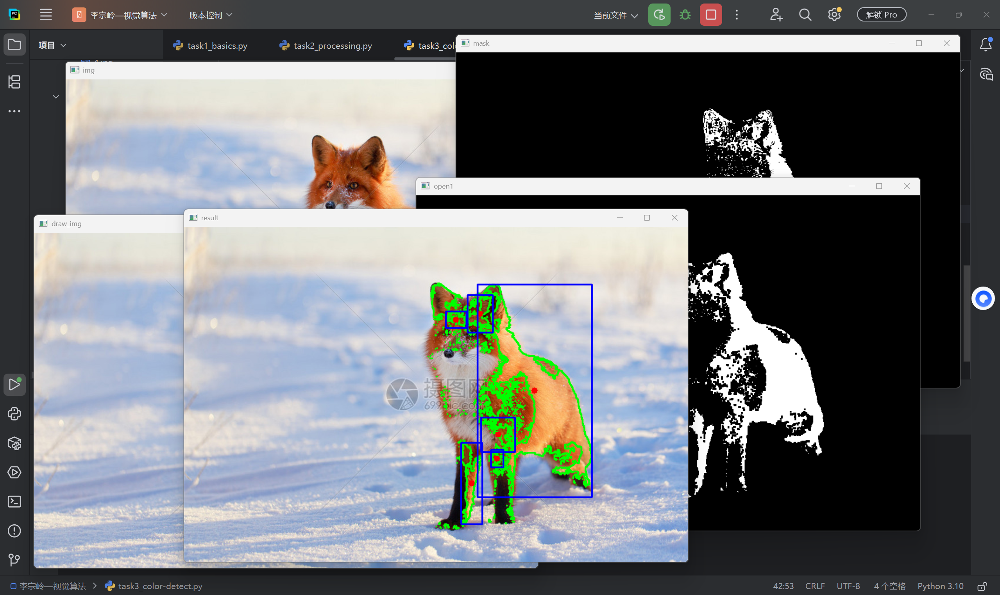
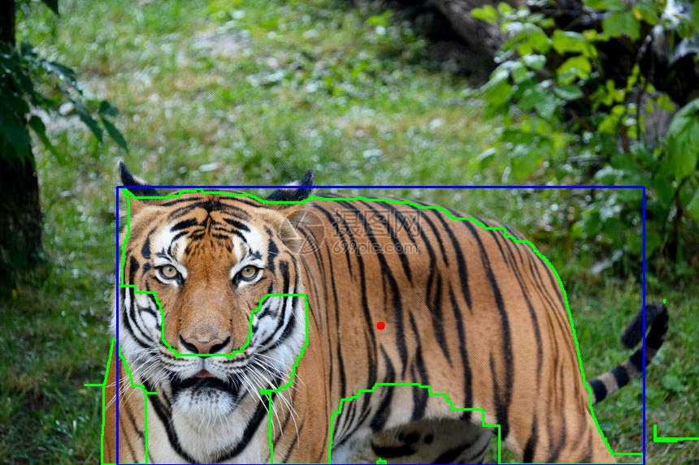
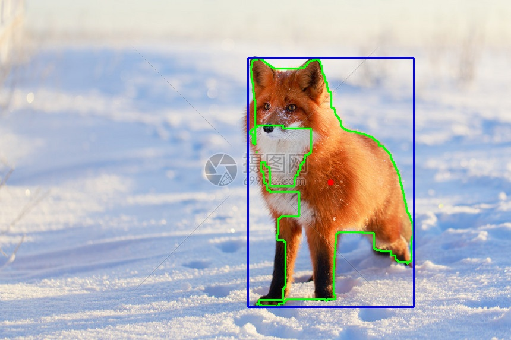
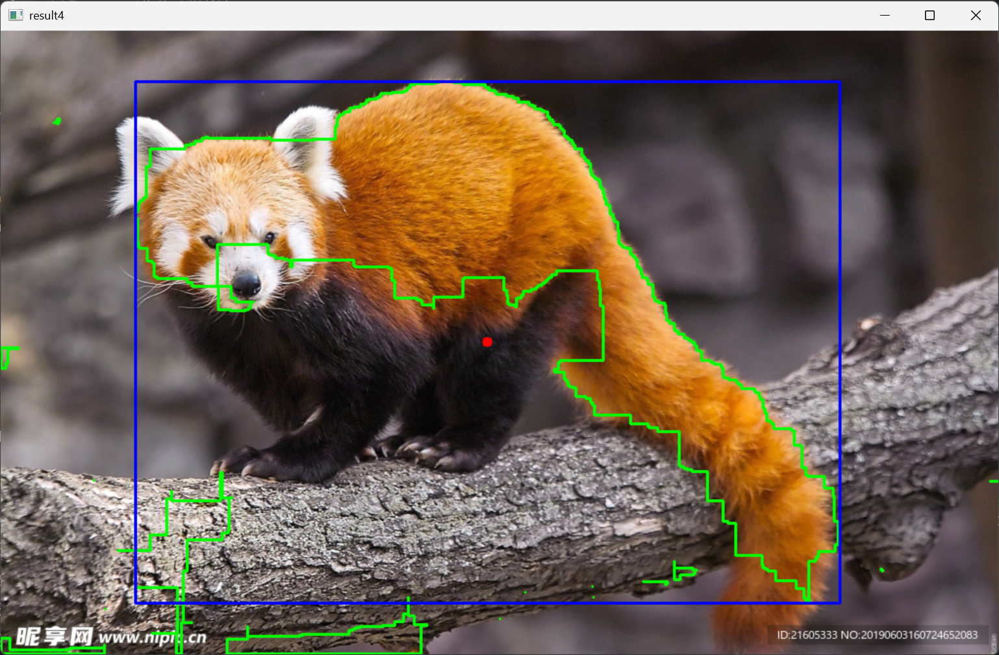
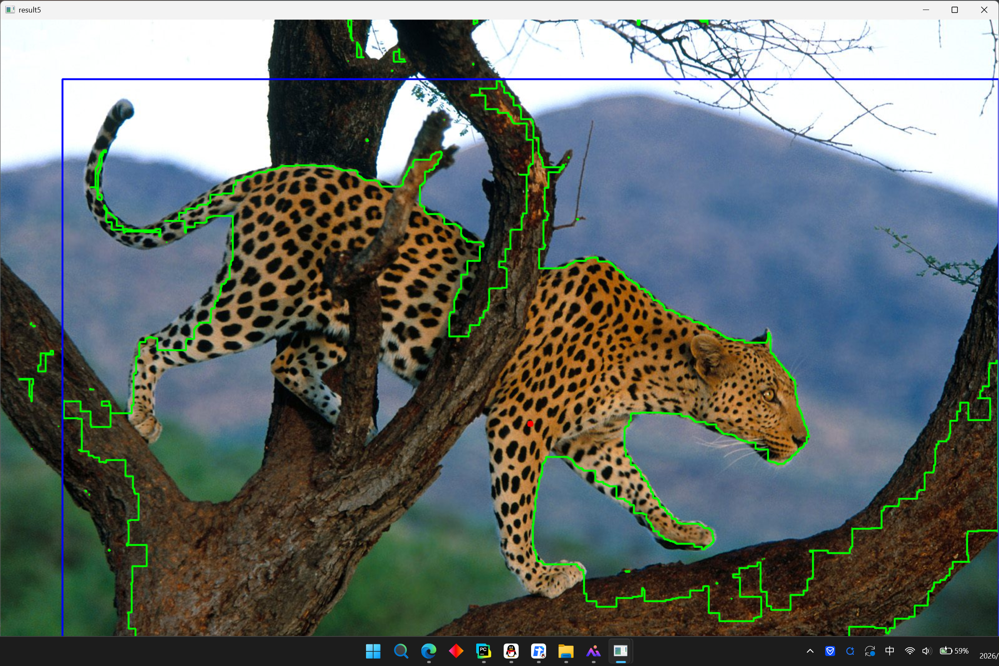

## 环境说明
*   **Python 版本**：3.10
*   **环境管理**：Anaconda

## 依赖安装与运行方式

1. 创建并激活 Conda 环境：
   conda create -n cv_practice python=3.10 -y
   conda activate cv_practice

2. 安装所需依赖包：
   pip install opencv-python numpy matplotlib

3. 运行验证脚本：
   python -c "import cv2, numpy; print(cv2.__version__)"

* 注：图片来源于网络（摄图网...）
##  关键参数与问题记录

1. **滤波前后变化是什么？**
   * 原图直接看，可能有一些细微的噪点或粗糙边缘。经过高斯滤波后，图像整体变得**平滑、柔和**了，原本尖锐的噪点被模糊掉了。发现核越大，图像越模糊；核越小，模糊程度越轻，细节保留越多。
   * 
   * 且发现(3, 11)（左图），在水平方向（X轴）上模糊程度较小，在垂直方向（Y轴）上模糊程度较大。右图为(11,3)，在水平方向（X轴）上模糊程度较大，在垂直方向（Y轴）上模糊程度较小。
   * 
2. **阈值调高或调低后哪些区域发生变化？**
   * 我对比了阈值 50、100 和 150 的效果。
   * 当阈值**较低**时，更多的区域变成了纯白色，保留了较多细节。
   * 当阈值**调高**时，白色的区域明显减少，只有非常亮的区域才会保留。这说明调高阈值会让筛选条件更严格。
   * 
   
   * 对比发现，如果不加高斯滤波直接分割，二值图中边缘毛刺和噪点较多；经过高斯滤波后再分割，二值图明显干净、连贯、柔和（左图进行了高斯滤波再分割，右图为原图分割）
   * 
3. **边缘是否完整？**
   * 在 Canny 边缘检测，目标的主要轮廓线条基本连贯，边缘提取较为完整。但因为有些区域对比度较低，或者受高斯滤波平滑的影响，极个别细节边缘出现了断裂。
   * 
   * 检测中发现第一个阈值越低，线条毛刺越多；越高，强边缘可能会出现断断续续。第二个阈值越高，线条保留下来的边缘越少，越不杂乱
4. **开运算或闭运算解决了什么问题？**
   * 开运算：先腐蚀后膨胀。作用是分离物体，消除小区域。特点是**消除噪点**，去除小的干扰块，而不影响原来的图像
   * 闭运算：先膨胀后腐蚀。作用是消除/闭合物体里面的孔洞，特点是可以**填充闭合区域**

5. **失败案例及改进思路**
   
* 失败案例：在测试狐狸图片时，由于狐狸毛发在阳光下有明暗变化（反光和阴影），导致提取的二值掩膜不连续，产生了多个小碎块。当面积阈值设置为 100 时，算法把这些碎块也当成了独立目标，画出了多个小框。
* 改进思路1：在进行 findContours 之前，加大形态学“闭运算”的卷积核（改用 15x15 的核），把狐狸身体断开的区域连接起来，这样就能只提取到一个完整的大轮廓。并将面积阈值扩大到5000。
* 然后发现整个图形依旧不能完整框住。原因是狐狸的头部、前腿（白色的那一大块）和后面的身体之间，有一条巨大的黑色裂缝。是因为狐狸前胸和脖子交界的地方是白毛，不在设置的“橙色” HSV 范围内，所以被抠成了黑色。
* 改进思路2：把所有碎块合并成一个整体，算一个最大围的大框(依旧使用核5x5，面积阈值100)
* 

* 对于第二组图片，遇到同样问题，想到用改进思路1，尝试更大的卷积核（40x40）,并且使用更大面积阈值，可得到：

* 尝试再次对第一组图片使用思路1，得到：
* 

* 继续尝试第三组图片

* 误检情况分析：在测试提取红熊猫时，算法成功框出了红熊猫的主体，但掩膜中出现了树干底部的部分边缘（误检）。分析原因：树干在光照下呈现黄褐色，且部分区域反光，其 HSV 值与红熊猫的橘红色毛发高度重合
* 第四组

 误检情况分析：在这张图中，算法完全失效，画出了一个几乎覆盖全图的大框。

1. 原因一（颜色重叠）：树干的树皮颜色是棕褐色的，在光照下其 HSV 值与豹子的黄毛高度重叠，导致树干被大面积提取为白色掩膜。
2. 原因二（面积阈值失效）：由于树干和豹子在掩膜中连在了一起，形成了一个面积巨大的连通域，我之前设置的面积过滤阈值不仅没能过滤掉它，反而把它当成了超大目标。

 
**补充HSV理解**
   * H（色相）：
   根据目标物体的实际颜色查表确定。比如提取橙色/黄色，H 范围就锁定在 [10, 30] 左右。范围不能太大，否则会把背景里的其他颜色也吸进来。
   * S（饱和度）：
   用来过滤灰白色背景。目标物体通常颜色鲜艳（S值高），把 S 的下限设高一点（比如 >100），可以让背景里的灰、白、黑变成纯黑，减少干扰。
   * V（明度）：用来过滤暗影。V 值不能设太高（比如 >80 即可），否则目标身上的暗部或阴影会被丢掉，导致提取出的物体断裂成碎片。

